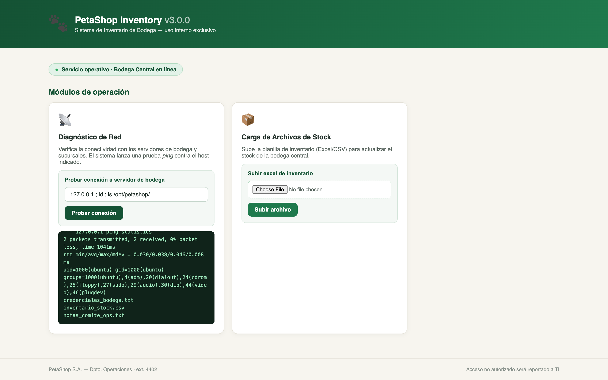
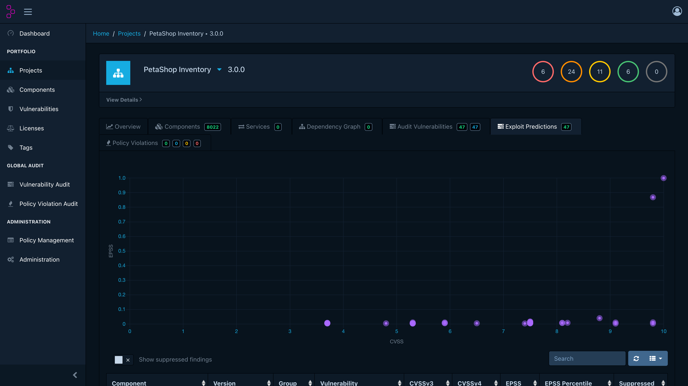

# VulnCorp Lab 03 — De la Vulnerabilidad al C2 (Simulación Red Team)

**Curso MAR303 — Universidad Mayor — 2026 — Profesor Tomás Vera**
**Prerrequisito:** Lab 02 (Syft + Grype + Dependency-Track)

---

## Descripción

VulnCorp Lab 03 simula el ciclo completo de una vulnerabilidad **no atendida**:

1. El equipo de seguridad escanea la infraestructura **PetaShop** con
   **Syft + Grype** (con un solo click desde un plugin de Chrome que solapa a
   **Dependency-Track**) y detecta dos bugs críticos de aplicación:
   **Inyección de Comandos** y **File Upload sin restricción**
   (escenarios oficiales de [OWASP VulnerableApp](https://github.com/SasanLabs/VulnerableApp)).
2. Analizan el riesgo con **EPSS** en Dependency-Track y envían el
   requerimiento de remediación… que **la gerencia ignora** (simulado).
3. El equipo asume el rol **Red Team**: despliega **[Mythic C2](https://github.com/its-a-feature/Mythic)**
   con el agente **Medusa**, explota la vulnerabilidad, instala el C2 en la
   máquina víctima y **exfiltra un archivo de credenciales** que contiene la
   flag del ejercicio.
4. Cierran con un informe de incidente que compara el costo de parchar vs. el
   costo del compromiso.

Trabajo en **equipos de 5 personas** con roles especializados
([docs/ROLES.md](docs/ROLES.md)).

> **ADVERTENCIA:** Contiene software intencionalmente vulnerable. Uso
> exclusivamente educativo, en red local aislada. No exponer a Internet.
> **No escanear ni atacar nada fuera de `localhost`.**

## Vistas del laboratorio

**Explotación desde el portal corporativo** — el equipo descubre la inyección
de comandos en el formulario de diagnóstico de PetaShop Inventory
(`uid=1000(ubuntu)` y el botín `credenciales_bodega.txt` a la vista):



**Priorización con EPSS en Dependency-Track** — el tab *Exploit Predictions*
muestra los 2 bugs de PetaShop arriba de todo (EPSS 99.999 % y 86.8 %,
percentil ~100) frente a las 45 vulnerabilidades de librerías:



---

## Arquitectura

```
┌──────────────────────────────────────────────────────────────────┐
│  TU COMPUTADOR (Docker Desktop)                                  │
│                                                                  │
│  ┌─────────── RED DE GESTIÓN (172.30.0.0/24) ───────────────┐    │
│  │                                                          │    │
│  │  ┌─────────────────────┐   ┌──────────────────────────┐  │    │
│  │  │ Dependency-Track    │   │ Webtop (noVNC)  :6080    │  │    │
│  │  │ Frontend :8083      │   │ Escritorio Xfce en el    │  │    │
│  │  │ API      :8084      │   │ navegador con Chromium   │  │    │
│  │  └─────────────────────┘   │ + extensión preinstalada │  │    │
│  │  ┌─────────────────────┐   │ + terminal               │  │    │
│  │  │ Orchestrator :8086  │◄─── click del plugin         │  │    │
│  │  │ Syft + Grype +      │   └──────────────────────────┘  │    │
│  │  │ upload a DTrack     │                                 │    │
│  │  └─────────────────────┘                                 │    │
│  └──────────────────────────────────────────────────────────┘    │
│                                                                  │
│  ┌─────────── RED VÍCTIMA (172.31.0.0/24) ──────────────────┐    │
│  │  ┌────────────────────────────────────────────────────┐  │    │
│  │  │ PetaShop Inventory :9090  (máquina vulnerable)     │  │    │
│  │  │  = OWASP VulnerableApp + python3 + evidencia       │  │    │
│  │  │  • CmdInjection   • FileUpload   • 🎯 /opt/petashop│  │    │
│  │  └────────────────────────────────────────────────────┘  │    │
│  └──────────────────────────────────────────────────────────┘    │
└──────────────────────────────────────────────────────────────────┘
                                ▲ callback HTTP (host.docker.internal)
              ┌─────────────────┴──────────────────┐
              │  MYTHIC C2 + Medusa                │
              │  (máquina del estudiante Rol 3)    │
              └────────────────────────────────────┘
```

### Componentes

| Componente | Imagen | Puerto | Rol |
|------------|--------|--------|-----|
| Dependency-Track API | `dependencytrack/apiserver:4.14.1` | 8084 | Análisis de SBOM, **EPSS**, NVD |
| Dependency-Track Frontend | `dependencytrack/frontend:4.14.1` | 8083 | Interfaz de gestión |
| PetaShop Inventory (víctima) | build propio sobre `sasanlabs/owasp-vulnerableapp:2.2.57` | 9090 | Command Injection + File Upload + evidencia |
| Orchestrator | build propio (`docker:27-cli` + Node 20) | 8086 | Syft + Grype + upload a DTrack, invocado por el plugin |
| Estación de trabajo | `lscr.io/linuxserver/webtop:ubuntu-xfce` | 6080/6081 | Escritorio en navegador (noVNC) con extensión preinstalada |
| Plugin de Chrome | `chrome-extension/` (MV3) | — | Panel flotante sobre DTrack → dispara el escaneo |
| Mythic C2 | fuera del compose (`docs/MYTHIC_SETUP.md`) | 7443/UI | Command and Control con agente Medusa |

**Syft y Grype NO se instalan en el host:** corren como contenedores oficiales
(`anchore/syft`, `anchore/grype`) usando el docker.sock — igual en Mac y Windows.

---

## Inicio rápido

### Requisitos

- Docker Desktop v24+ con **8 GB de RAM** asignados (Settings → Resources)
- 15 GB de disco
- Git

### macOS / Linux

```bash
git clone <URL-del-repositorio> && cd vulncorp-lab03-c2
chmod +x scripts/setup.sh
./scripts/setup.sh
```

### Windows (PowerShell)

```powershell
git clone <URL-del-repositorio> && cd vulncorp-lab03-c2
.\scripts\setup.ps1
```

> **Apple Silicon:** habilita "Use Rosetta for x86_64/amd64 emulation" en
> Docker Desktop → Settings → General.

### URLs de acceso

| Servicio | URL | Credenciales |
|----------|-----|--------------|
| Estación de trabajo (noVNC) | http://localhost:6080 | — |
| Dependency-Track | http://localhost:8083 | admin / admin (primera vez) |
| Dependency-Track API | http://localhost:8084 | — |
| PetaShop Inventory (víctima) | http://localhost:9090 | — |
| Orchestrator API | http://localhost:8086/api/health | — |
| Mythic (equipo Rol 3) | https://127.0.0.1:7443 | ver docs/MYTHIC_SETUP.md |

### Detener el laboratorio

```bash
docker compose down -v
```

---

## Flujo del ejercicio (resumen)

| Fase | Rol líder | Qué hace |
|------|-----------|----------|
| 0 — Setup | Todos | Levantar entorno, DTrack, extensión |
| 1 — Análisis | 🔍 Analista | Escaneo Syft+Grype desde el plugin → DTrack → EPSS |
| 2 — Riesgo | 📝 Documentador | Informe + requerimiento de remediación **ignorado** |
| 3 — C2 | 🐍 Operador C2 | Instalar Mythic + Medusa (guía dedicada) |
| 4 — Explotación | 💥 Explotador | Command Injection o Upload → despliegue de Medusa |
| 5 — Exfiltración | 📦 Exfiltrador | Descargar la evidencia con C2, hashes, cadena de custodia |
| 6 — Informe final | 📝 + todos | Cronología, lecciones, presentación |

Detalle completo: [docs/LAB_03_STUDENT.md](docs/LAB_03_STUDENT.md)

---

## Estructura del repositorio

```
vulncorp-lab03-c2/
├── docker-compose.yml           # Lab 03: DTrack + víctima + orchestrator + noVNC
├── README.md                    # Este archivo
├── vulnerable-app/              # Máquina vulnerable
│   ├── Dockerfile               # VulnerableApp + python3 + evidencia
│   └── files/                   # Archivos "corporativos" (incluye la flag)
├── orchestrator/                # Servicio Syft+Grype+DTrack
│   ├── Dockerfile
│   ├── package.json
│   └── src/server.js
├── chrome-extension/            # Plugin MV3 que solapa a Dependency-Track
│   ├── manifest.json
│   ├── background.js
│   ├── content.js
│   └── styles.css
├── novnc/
│   └── custom-cont-init.d/      # Autoconfiguración de la estación de trabajo
├── scripts/
│   ├── setup.sh                 # Setup (macOS / Linux / Git Bash)
│   └── setup.ps1                # Setup (Windows PowerShell)
├── data/                        # Reportes y evidencias (gitignored)
│   └── exfiltracion/            # Carpeta compartida con el noVNC
└── docs/
    ├── LAB_03_STUDENT.md        # Guía del estudiante
    ├── LAB_03_INSTRUCTOR.md     # Guía del instructor (confidencial)
    ├── ROLES.md                 # Matriz de 5 roles y entregables
    └── MYTHIC_SETUP.md          # Instalación de Mythic (Rol 3)
```

---

## Compatibilidad

| Arquitectura | Plataforma | Estado |
|--------------|-----------|--------|
| AMD64 (x86_64) | Intel/AMD (Windows, Mac Intel) | ✅ Totalmente compatible |
| ARM64 (aarch64) | Apple Silicon M1/M2/M3/M4 | ✅ Totalmente compatible |

Todas las imágenes usadas publican build multi-arquitectura (verificado en
Docker Hub). Syft/Grype corren con su imagen oficial correspondiente a la
arquitectura del host automáticamente.

### Requisitos de recursos

| Recurso | Mínimo | Recomendado |
|---------|--------|-------------|
| RAM (Docker Desktop) | 6 GB | 8 GB |
| Disco | 10 GB | 15 GB |
| CPU | 2 cores | 4 cores |

---

## Créditos

- **Profesor:** Tomás Vera — Universidad Mayor — 2026
- Herramientas: [Syft](https://github.com/anchore/syft),
  [Grype](https://github.com/anchore/grype),
  [Dependency-Track](https://dependencytrack.org/) (OWASP),
  [VulnerableApp](https://github.com/SasanLabs/VulnerableApp) (OWASP),
  [Mythic](https://github.com/its-a-feature/Mythic) + [Medusa](https://github.com/MythicAgents/Medusa),
  [Webtop](https://github.com/linuxserver/docker-webtop) (linuxserver.io), Docker
- Marco de referencia: MITRE ATT&CK, CVE, CVSS, EPSS, CISA KEV

---

## Licencia

Material de uso exclusivamente educativo para el curso MAR303 de la
Universidad Mayor. El software vulnerable incluido es propiedad de sus
respectivos autores y se utiliza con fines de enseñanza.
